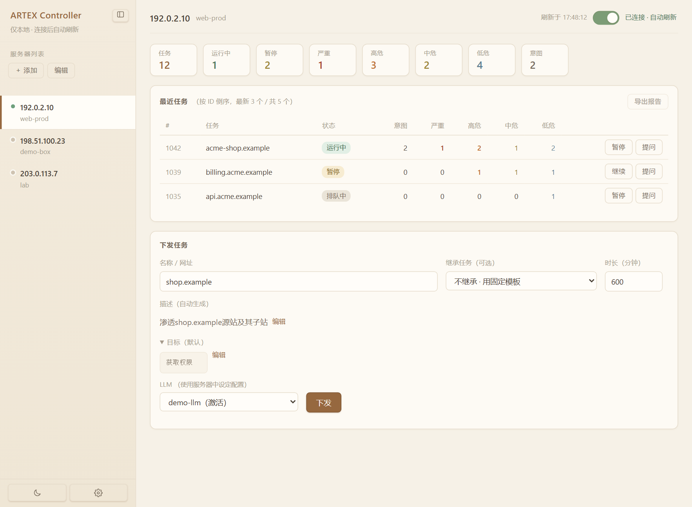
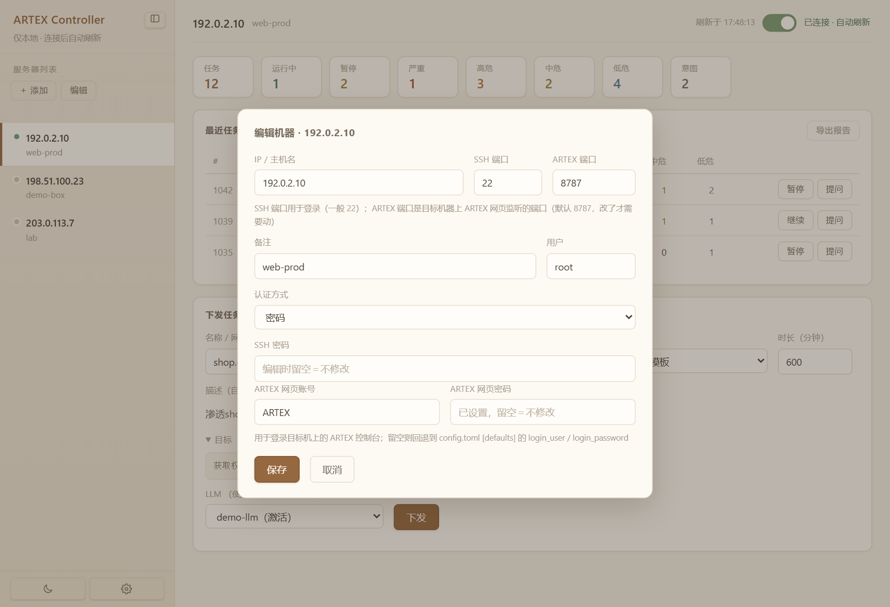
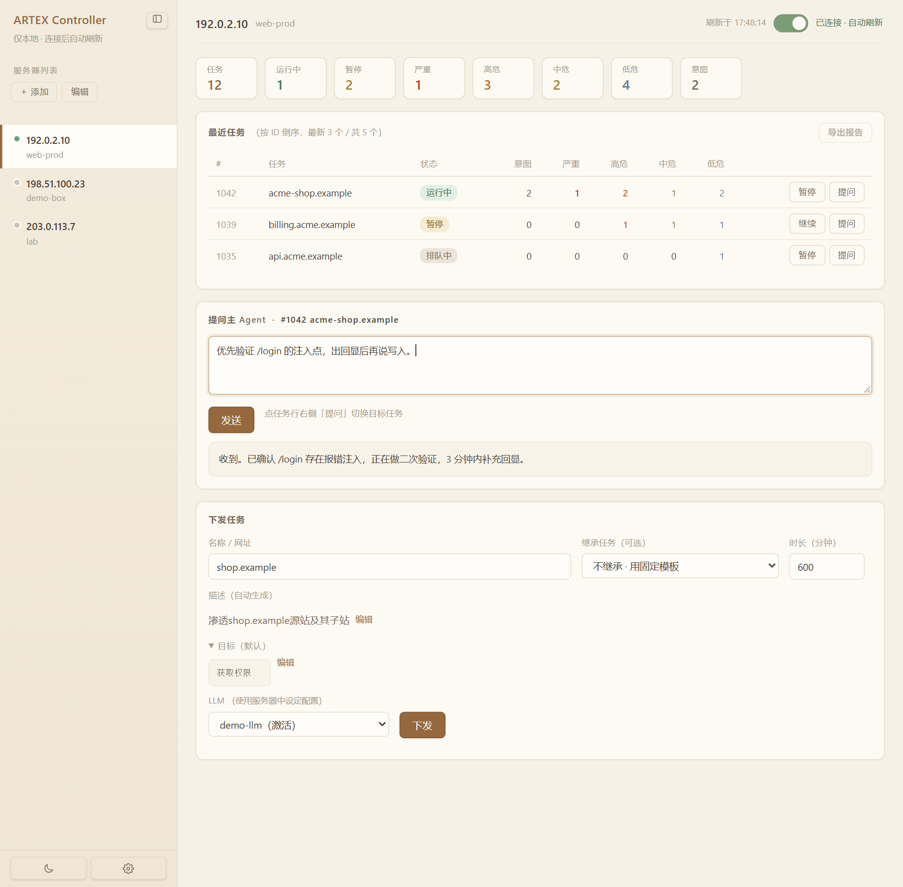
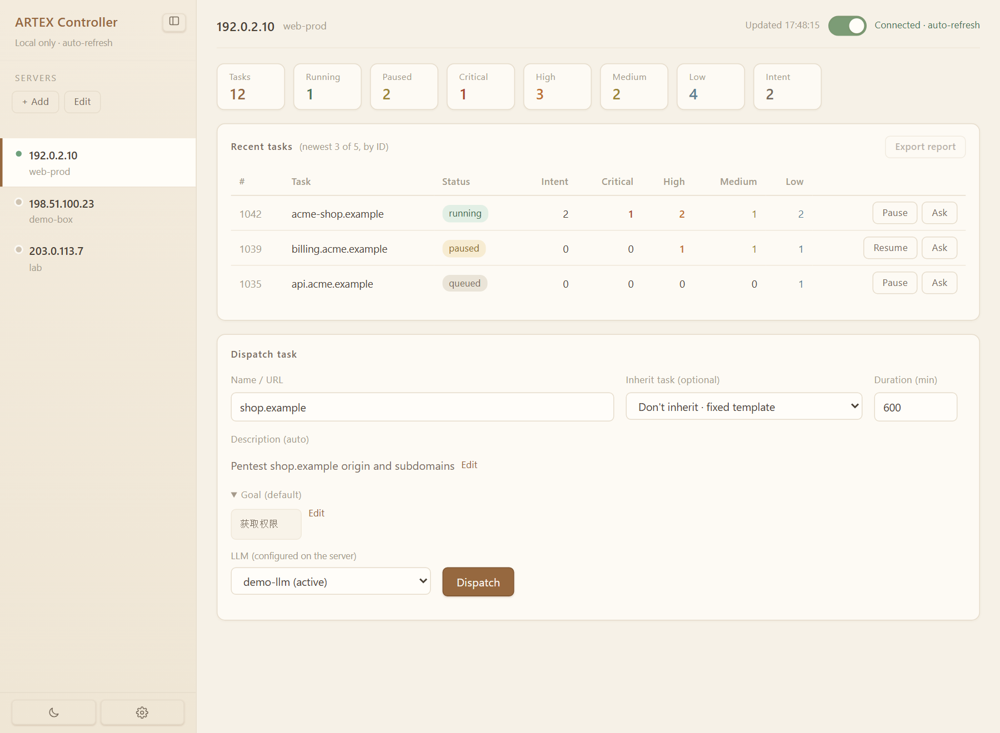
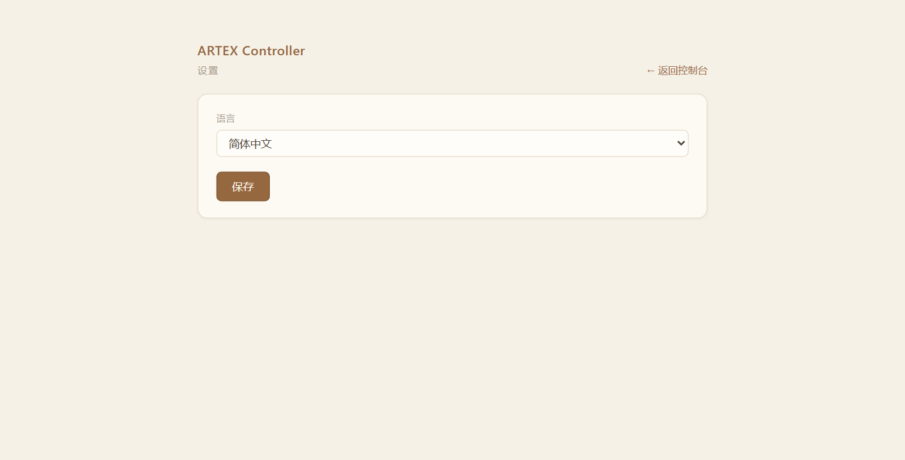
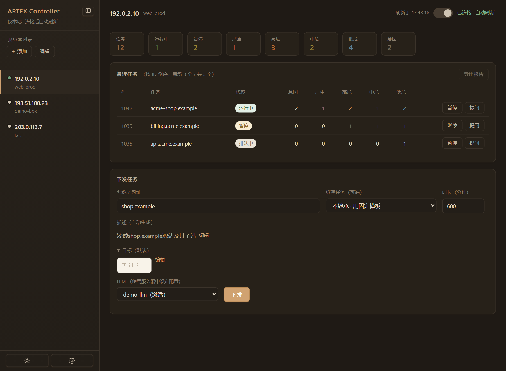

# ARTEX Controller

本地多机 ARTEX 控制台：通过 SSH 隧道连接各台目标机上的 ARTEX（默认 8787），在一个本地网页里统一查看任务、下发任务、暂停/继续、提问主 Agent 和导出报告。

只在本机运行（`127.0.0.1`），所有 SSH 均由本机主动向外发起。

## 功能

- **服务器列表**：添加 / 编辑 / 删除；支持密码或私钥登录；侧栏可折叠
- **SSH 隧道**：把目标机的 ARTEX 端口映射到本地随机端口，网页端无感访问；主机密钥首次记录、之后逐次校验
- **面试板**：任务总数、运行中、暂停、严重 / 高危 / 中危 / 低危、进行中意图
- **最近任务**：按 ID 倒序，支持暂停 / 继续、选中后导出报告
- **下发任务**：名称、时长、LLM（用服务器上已配好的）、可选继承已有任务；描述自动生成、目标默认「获取权限」，两者均可临时编辑
- **提问主 Agent**：对选中任务发指令并查看回复（Ctrl+Enter 发送）
- **导出报告**：总报告 + 全部严重 / 高危单漏洞报告，落到 `machine/<IP>/<任务名>/`
- **界面**：夜间模式（侧栏底部）、简体中文 / English（独立设置页，写入 `config.toml`）
- **启动**：`start.bat` 自动检查 Python 与依赖、自动生成配置、把黑窗最小化到任务栏

## 界面预览

> 截图使用虚构的服务器地址与任务数据（`192.0.2.x`、`example` 域名），不含真实目标信息。

| 主界面 · 概览 / 最近任务 / 下发任务 | 编辑机器 |
| --- | --- |
|  |  |

| 提问主 Agent | 界面 · English |
| --- | --- |
|  |  |

| 设置 · 语言 | 夜间模式 |
| --- | --- |
|  |  |

## 环境要求

- Windows 10 / 11（启动脚本与窗口启动器针对 Windows）
- Python 3.11+（读取 `config.toml` 需要标准库 `tomllib`）
- [paramiko](https://www.paramiko.org/)

## 快速开始

```bat
git clone <你的仓库地址>
cd artex_controller_clean
pip install -r requirements.txt
copy config.example.toml config.toml
```

然后编辑 `config.toml` 里的 `[defaults]`（ARTEX 网页账号密码等），双击 **`start.bat`**。
首次运行时若没有 `config.toml`，脚本会自动从 `config.example.toml` 生成一份。

启动后会自动打开独立窗口（Chrome/Edge 的 `--app` 模式）；控制台窗口最小化在任务栏，**关掉它即停止服务**。

接着在左侧「＋ 添加」录入服务器：

| 字段 | 说明 |
| --- | --- |
| IP / 主机名、SSH 端口 | 登录目标机用（一般 22） |
| 用户、SSH 密码 / 私钥 | SSH 认证方式二选一 |
| ARTEX 端口 | 目标机上 ARTEX 网页监听的端口（默认 8787） |
| ARTEX 网页账号 / 密码 | 登录目标机上的 ARTEX 控制台；留空则回退到 `[defaults]` 的 `login_user` / `login_password` |

点右上角开关建立连接，连上后每 8 秒自动刷新；保存机器后会自动退出编辑模式。

## 配置说明

配置由界面写回，也可手工编辑（保存时会自动备份为 `config.toml.bak`）。

```toml
[defaults]
artex_port = 8787           # ARTEX 默认端口
login_user = "ARTEX"        # ARTEX 网页默认账号
login_password = "..."      # ARTEX 网页默认密码（机器单独填的优先）
timeout_minutes = 600       # 下发任务默认时长（分钟）
goal = """..."""            # artex_dispatch.py 的默认目标（网页控制台默认「获取权限」）

[console]
port = 8900                 # 控制台网页端口
lang = "zh"                 # zh / en

[[machines]]                # 每台服务器一段，由界面维护
ip = "192.168.1.10"
user = "root"
port = 22
ssh_password = "..."
artex_port = 8787
artex_user = "ARTEX"
artex_password = "..."
```

## 命令行

```bat
python artex_console.py [-c config.toml] [--port 8900] [--no-browser]
                        [--window-size 1040x780] [--minimize-console]
```

`--minimize-console` 仅 Windows 有效，启动后把控制台窗口最小化（`start.bat` 默认带上）。

## 目录结构

```
├── artex_console.py    主程序（网页控制台 + SSH 隧道）
├── artex_dispatch.py   命令行下发工具（批量清理测试任务用）
├── start.bat          Windows 启动脚本（GBK 编码）
├── config.example.toml 配置示例
├── config.toml         本地配置（含明文密码，已被 .gitignore 忽略）
├── icon.ico            窗口 / 网页图标
├── ssh_host_keys.json  SSH 主机密钥指纹（首次连接后生成）
├── keys/               私钥文件（使用密钥登录时从界面导入）
└── machine/            导出的报告
```

## 数据与安全

- 网页只监听 `127.0.0.1`，外部访问不到；请求带 Host / Origin 校验，防 DNS rebinding 与跨站调用
- SSH 主机密钥指纹首次连接时记录到 `ssh_host_keys.json`，之后每次比对，不一致直接拒绝
- `config.toml` 中是**明文** SSH / ARTEX 密码，请自行控制文件权限，不要提交到仓库
- `.gitignore` 已排除 `config.toml`、`ssh_host_keys.json`、`keys/`、`machine/`；上传 GitHub 前可用 `git status` 再确认一次

## 常见问题

- **8900 端口被占用**：`python artex_console.py --port 8901`，或关掉占用进程
- **双击后黑窗消失**：已最小化到任务栏，属正常现象；恢复后关闭即停止服务
- **连不上目标机**：先确认 SSH 能登录（端口、用户、密码 / 私钥），再确认目标机上 ARTEX 正在监听 `artex_port`，最后确认 ARTEX 网页账号密码正确
- **首次打开报缺少 `config.toml`**：双击 `start.bat` 会自动从 `config.example.toml` 生成，或手动 `copy` 一份

## 免责声明

本项目仅用于**已获得授权**的安全测试、红队演练与自有资产排查。使用者需自行确保对目标系统的测试行为合法合规，并承担由此产生的一切责任。
